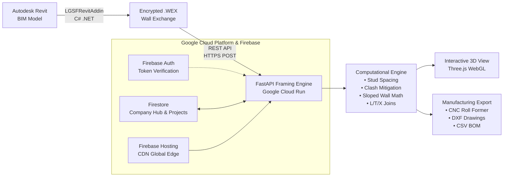

# FrameX: Intelligent "Model-to-Machine" LGSF Automation Platform

<div align="center">

[-success?style=for-the-badge&logo=pytest&logoColor=white)](tests/)
[](https://python.org)
[](https://fastapi.tiangolo.com)
[-4285F4?style=for-the-badge&logo=googlecloud&logoColor=white)](https://cloud.google.com/run)
[](https://firebase.google.com)
[](https://threejs.org)
[](LICENSE.md)

**A Next-Generation Light Gauge Steel Framing (LGSF) Automation Engine**  
*Submitted for the Google AI Builder Cup 2026 by **Team Dexterlab** (Arshad Ali & Raunak Chandak)*

[🌐 Live Web Application](https://framexdexterlab.web.app) • [📖 Architecture & Design](DESIGN.md) • [⚖️ Evaluation License](LICENSE.md)

</div>

---

## 🚀 Overview

Light Gauge Steel Framing (LGSF) is the future of modular, sustainable, off-site construction. However, turning architectural BIM models (Autodesk Revit) into manufacturing-ready framing requires **3 to 5 days of error-prone manual CAD modeling per villa**.

**FrameX** transforms this workflow into an autonomous, 1-click **"Model-to-Machine"** pipeline:
1. **BIM Extraction:** Our custom C# Revit Add-in extracts parametric wall geometries, structural layers, openings, and joins into an encrypted `.wex` (Wall Exchange) package.
2. **Computational Geometry Engine:** Our sub-85ms framing engine calculates exact structural member layouts (studs, tracks, kings, trimmers, sills, headers, cripples, and noggings) with tolerance clash mitigation.
3. **Interactive 3D Web Visualization:** Architects and structural engineers inspect framing in real-time in an interactive Three.js 3D viewport with realistic C-section and U-track profiles.
4. **CNC & Fabrication Export:** Instant generation of CNC roll-forming machine instructions, DXF shop drawings, and accurate Bill of Materials (BOM).

---

## 🏗️ System Architecture



---

## ⚡ Performance & Quality Benchmarks

| Metric | Benchmark Result | Industry Standard (Manual) |
| :--- | :---: | :---: |
| **Wall Framing Execution Time** | **< 85 ms** per complex wall | 2 – 4 hours per wall |
| **End-to-End API Response Time** | **~120 ms** (Google Cloud Run) | Multi-day turnaround |
| **Automated Test Coverage** | **60 / 60 Unit Tests Passing (100%)** | Manual visual inspection |
| **Cloud Hosting & Serverless Cost** | **< $30 / month** on Google Cloud | Expensive on-prem desktop seats |
| **Framing Tolerance Precision** | **±0.5 mm** manufacturing tolerance | Variable human error |

---

## ✨ Key Algorithmic Innovations

- **Parametric Opening Framing:** Automatically generates structural King Studs, Trimmer Studs, Box Headers, Sills, and Cripple Studs around windows and doors based on load requirements.
- **Dynamic Clash Mitigation:** Evaluates spatial clearances between standard field studs and opening members; eliminates duplicate studs violating flange clearance tolerances.
- **Sloped & Gabled Wall Trigonometry:** Calculates variable stud heights for non-orthogonal, pitched, and cathedral roof wall profiles.
- **Multi-Wall Corner & Join Resolution:** Automatically computes L-joins, T-joins, and X-joins, calculating track cutbacks and injecting backing studs for drywall attachment.
- **Mid-Height Nogging / Blocking:** Automatically places interlocking noggings at structural bracing heights to prevent lateral torsional buckling.

---

## 📁 Repository Structure

```
FrameX/
├── src/                          # Core Framing & Computational Geometry Engine
│   ├── models.py                 # Pydantic & Dataclass domain models (Wall, Member, Profile)
│   ├── framing_engine.py         # Primary stud layout orchestrator & clash filters
│   ├── opening_handler.py        # Windows, doors, headers, sills, and cripples
│   ├── join_detector.py          # L-join, T-join, X-join corner calculations
│   ├── nogging_placer.py         # Mid-height lateral blocking placement
│   ├── visualizer.py             # Matplotlib 2D elevation generator
│   ├── exporter.py               # JSON, DXF, and CSV export adapters
│   └── security.py               # AES-GCM .wex encryption/decryption utilities
├── web/                          # Web Platform Frontend
│   ├── index.html                # Main application dashboard
│   ├── app.js                    # Web UI logic & API client
│   ├── viewer3d.js               # Three.js 3D steel profile renderer
│   └── auth.js                   # Firebase Authentication client
├── tests/                        # Comprehensive Automated Test Suite (60 Tests)
│   ├── test_complex_framing.py   # Complex wall geometry & multi-opening tests
│   ├── test_joins.py             # Corner & intersection tolerance tests
│   ├── test_sloped_walls.py      # Pitched roof height calculation tests
│   ├── test_structural_layer.py  # Layer offset and thickness validation
│   └── test_company_hub.py       # Multi-tenant organization tests
├── revit-addin/                  # Autodesk Revit C# .NET Add-in & BIM Integrator
│   ├── Commands/                 # Revit Ribbon commands (ExportWalls, ImportFraming)
│   ├── Core/                     # Wall extraction & native Revit FamilyInstance builder
│   ├── Models/                   # Revit BIM export data schema
│   ├── Families/                 # Parametric .rfa structural framing families (SSMA C-studs)
│   ├── installer/                # Pre-compiled 1-click Windows Installer (.exe)
│   ├── App.cs                    # Revit UI external application
│   └── LGSFRevitAddin.csproj     # Multi-targeting .NET 8 / .NET Framework 4.8 project
├── configs/                      # Regional LGSF standards (US, UK, AUS, IND)
├── Dockerfile                    # Production multi-stage container definition
├── cloudbuild.yaml               # Google Cloud Build pipeline
├── firebase.json                 # Firebase Hosting rewrites to Cloud Run
├── server.py                     # FastAPI backend & Firebase Admin token verification
└── LICENSE.md                    # Google AI Builder Cup Evaluation License
```

---

## 🛠️ Quick Start & Local Development

### Prerequisites
- Python 3.10+ (Python 3.12 recommended)
- Node.js 18+ (for Firebase CLI deployment, optional)

### 1. Clone & Setup Virtual Environment
```bash
git clone https://github.com/frmxbydexterlab/FrameX.git
cd FrameX

# Create and activate virtual environment
python -m venv .venv
source .venv/bin/activate    # On Linux/macOS
.venv\Scripts\activate       # On Windows

# Install dependencies
pip install -r requirements.txt
```

### 2. Run the Automated Test Suite
Verify that all 60 tests pass:
```bash
python -m pytest tests/ -v
```

### 3. Launch the Local Development Server
```bash
python server.py
```
Open [http://localhost:8000](http://localhost:8000) in your browser.

---

## ☁️ Google Cloud & Firebase Deployment

FrameX is architected for zero-maintenance serverless scalability on Google Cloud Platform:

```bash
# Build & Deploy to Google Cloud Run
gcloud builds submit --config cloudbuild.yaml

# Deploy Firebase Hosting rewrites
firebase deploy --only hosting
```

---

## 👥 Team Dexterlab (Google AI Builder Cup)

- **Arshad Ali** — *Full-Stack Cloud & Algorithmic Architecture*
- **Raunak Chandak** — *BIM / Revit Integration & Computational Geometry*

**Contact:** frmxbydexterlab@gmail.com  
**Live Platform:** [https://framexdexterlab.web.app](https://framexdexterlab.web.app)

---

## ⚖️ License & Intellectual Property

This software and its underlying framing algorithms are proprietary intellectual property of **Dexterlab**.  
As specified in [LICENSE.md](LICENSE.md), permission is granted to judges and authorized evaluators of the **Google AI Builder Cup** to review, clone, and execute this code for competition scoring. All commercial reproduction, extraction, or redistribution is strictly prohibited.
